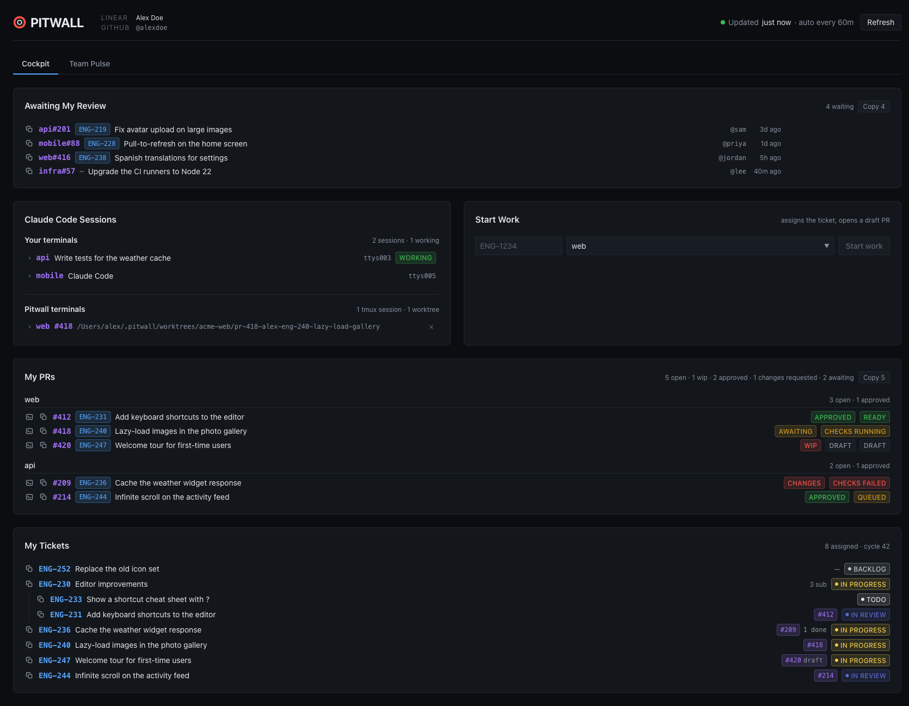
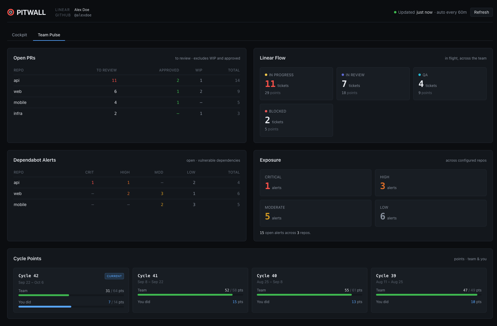

# Pitwall

[](https://github.com/ShipAngel/pitwall/actions/workflows/ci.yml)
[](./LICENSE)

**Your PRs, your tickets and your team's flow, on one screen.**

Pitwall is a developer tool you run yourself, on your own Mac. Clone it, add
your own GitHub and Linear tokens, start it, and keep it open in a browser tab.
It pulls together GitHub, Linear and the Claude Code sessions running in your
terminals, so you can see what needs you without clicking through three tools.

> **Everything stays on your machine.** Your copy runs on `localhost`, talks to
> GitHub and Linear with your own tokens, and shows your own view. Each developer
> on a team runs their own copy.





*Screenshots use made-up data.*

## Why

In Formula One, the pit wall is where the strategists sit. They don't drive the
car. They watch the telemetry for every car on track, spot trouble early, and
make the call on when to come in.

Pitwall does that job for a small engineering team. A normal day means checking
GitHub for PRs that need a review or have gone red, Linear for what's in flight,
and a stack of terminals for whichever Claude Code session has finished its turn.
Pitwall puts all three on one screen and keeps it fresh in the background, so
you spend your attention on the work rather than on finding it.

It was built at [Ship Angel](https://shipangel.com) for our own team and is used
every day. It is macOS only, because watching and focusing your terminal sessions
is half the point.

## What you get

- **My PRs:** your open PRs grouped by repo, with CI status, review state and a
  merge verdict that understands merge queues and cancelled runs.
- **Awaiting my review:** PRs waiting on you, oldest first, with author and age.
- **My tickets:** your open Linear tickets in their real status colours, with
  sub-issues nested and their PRs linked.
- **Team Pulse:** open PRs per repo, work in flight per Linear status, cycle
  points, and Dependabot alerts by severity.
- **Start Work:** type a ticket id and Pitwall assigns it to you, moves it to In
  Progress, pushes a branch and opens a draft PR.
- **Claude Code sessions:** every terminal running Claude Code, with a badge when
  it's mid-turn. Click one to bring that iTerm2 window to the front.
- **Per-PR terminals** (off by default): a persistent terminal for each PR,
  running in that PR's own git worktree, docked at the bottom of the page.

Nothing is written to GitHub or Linear except by Start Work, which only runs when
you press its button. On your own machine, per-PR terminals run commands, and
cleaning one up can end its session and remove the worktree Pitwall made for it.

## Before you start

| You need | For |
|---|---|
| **macOS** | Everything. The session scanner uses `ps`, `lsof` and AppleScript. |
| **Node 20+** | Running Pitwall. `.nvmrc` pins the version. |
| **A GitHub token** | Every GitHub panel, and Start Work. github.com only; GitHub Enterprise Server isn't supported. |
| **A Linear API key** | Every Linear panel, and Start Work. |
| **iTerm2** | Focusing Claude Code sessions. Other terminals are listed but can't be focused. |
| **tmux** (optional) | Per-PR terminals. `brew install tmux`. |
| **Claude Code** (optional) | The sessions panel, and the default command in per-PR terminals. |

Pitwall is **one person's view**. "My PRs" means whoever owns the GitHub token,
and "My tickets" whoever owns the Linear key. Each person runs their own copy on
their own machine, and it stays on `localhost` (see [Security](#security)).

## Setup

### 1. Clone and install

```sh
git clone https://github.com/ShipAngel/pitwall.git
cd pitwall
npm install --no-save
```

### 2. Add your tokens

```sh
cp .env.local.example .env.local
```

Then fill in both values. **Both are required.** Without them every panel shows
`GITHUB_TOKEN is not set` or `LINEAR_API_KEY is not set` instead of data.

| Variable | Create it at | What it needs |
|---|---|---|
| `GITHUB_TOKEN` | [github.com/settings/tokens](https://github.com/settings/tokens), a **classic** token | `repo` and `read:user` |
| `LINEAR_API_KEY` | [linear.app/settings/account/security](https://linear.app/settings/account/security), a personal API key | Nothing extra. It sees what you can see in Linear. |

Three things that will otherwise cost you an afternoon:

- **Use `repo`, not `public_repo`,** if any repo you track is private. A
  `public_repo` token silently reports zero open PRs for every private repo.
- **Authorise the token for SAML SSO** if your organisation uses it, from the
  *Configure SSO* menu next to the token. Otherwise GitHub returns `403` for every
  private repo even with the right scopes.
- **Dependabot alerts need write, maintain or admin access** to a repo. Repos you
  can't read alerts for show zeros, so a quiet Security panel may be permissions.
  With a fine-grained token, grant *Dependabot alerts: read* as well.

The tokens are read on the server and never reach the browser. `.env.local` is
read once at startup, so **restart Pitwall after changing it.**

### 3. Tell it what to watch

```sh
cp config.example.json config.json
```

Open `config.json` and change two things:

- **`repos`:** the GitHub repos you want to track, as `owner` and `name`. Every
  panel is scoped to this list, including the review queue.
- **`linear.teamKey`:** your Linear team's ticket prefix, e.g. `ENG` for `ENG-123`.

```json
{
  "repos": [
    { "owner": "your-org", "name": "your-repo", "localPath": "~/Dev/your-repo" },
    { "owner": "your-org", "name": "another-repo" }
  ],
  "linear": {
    "teamKey": "ENG",
    "inProgressStatusName": "In Progress"
  },
  "refreshIntervalSeconds": 300,
  "wipLabel": "wip",
  "hotspotThreshold": 10,
  "terminals": {
    "enabled": false,
    "worktreeRoot": "~/.pitwall/worktrees",
    "command": ["claude"]
  }
}
```

Everything else can stay as it is. `localPath` is only used by per-PR terminals.
Unlike `.env.local`, `config.json` is re-read on every request, so a page refresh
picks up changes. Every setting is listed under [Configuration](#configuration).

### 4. Start it

```sh
./start.sh
```

Then open **http://localhost:3737**.

`start.sh` checks your Node version, syncs dependencies, creates `.env.local` and
`config.json` from the examples if they're missing, warns about config keys
you're missing or no longer need, and starts the server. It also starts the
terminal server when terminals are turned on. `./start.sh prod` serves a
production build instead.

### 5. Check it worked

You should see the **Cockpit** tab with your PRs and tickets, and a **Team Pulse**
tab beside it. If something's wrong, Pitwall says what rather than showing an
empty panel:

| You see | Do this |
|---|---|
| "Pitwall can't start yet" and a config message | Fix `config.json` as the message says and refresh. |
| `GITHUB_TOKEN is not set` / `LINEAR_API_KEY is not set` | Fill in `.env.local`, then restart. |
| `GitHub API 401` | The token is wrong, expired or revoked. |
| "Couldn't read owner/name" | That repo is misspelled in `config.json`, or your token can't see it. |
| "Linear has no team with key ..." | `linear.teamKey` doesn't match a team your key can see. |

More in [Troubleshooting](#troubleshooting).

## How Pitwall reads your workflow

Pitwall works with ordinary GitHub and Linear setups, but a few things work best
when your team does them:

- **Ticket ids in PRs.** A PR is linked to its Linear tickets through Linear's own
  GitHub integration, or by a ticket id in the PR title (`[ENG-123] Subject` or
  `ENG-123: Subject`) or branch (`alex/eng-123-subject`, `feature/ENG-123-x`). Only
  real team keys from your Linear workspace count, so `HTTP-2` is never a ticket.
- **A work-in-progress label.** PRs carrying the `wipLabel` label (default `wip`)
  are left out of the "to review" counts. If your team doesn't use one, nothing
  changes.
- **Linear statuses.** The flow panel shows whatever Linear files as *started*, in
  Linear's own order and colours, so renaming or adding a status needs no change
  here.
- **Cycles and estimates.** Cycle Points and point totals appear only if your team
  uses them in Linear.
- **One Linear team.** Team Pulse and Cycle Points follow the team in
  `linear.teamKey`. "My tickets" shows your tickets from every team.

### Start Work

Start Work is the only part of Pitwall that changes anything in GitHub or Linear.
Given a ticket id and a repo, it:

1. Refuses straight away if the ticket is assigned to **someone else**, before
   writing anything.
2. Pushes a branch named by Linear (its "copy git branch name"), with one empty
   commit, and opens a **draft PR** titled `[ENG-123] Ticket title`.
3. Assigns the ticket to you and moves it to `linear.inProgressStatusName`, or to
   your team's first *started* status if that name doesn't exist. A ticket already
   past that point is never moved backwards.

Running it again is safe: it reuses the branch if it exists, and an open PR on it
if there is one. If that PR was closed, it opens a new draft PR on the same branch.

The empty commit is made through GitHub's API and isn't signed, so a rule
requiring signed commits on every branch will refuse it.

A fine-grained GitHub token without *Contents: write* and *Pull requests: write*
leaves the rest of the dashboard working and makes Start Work fail with a clear error.

## Configuration

`config.json` is gitignored, and `config.example.json` is the committed template.
Bad values fail loudly and name the setting.

| Key | Required | What it does |
|---|---|---|
| `repos` | yes | GitHub repos to track, as `{ owner, name }`. Scopes every GitHub panel, including the review queue. |
| `repos[].localPath` | no | Your clone of that repo (`~` allowed). Only used by [per-PR terminals](#per-pr-terminals). |
| `linear.teamKey` | yes | Your Linear team's ticket prefix: `ENG` for `ENG-123`. |
| `linear.inProgressStatusName` | no | The status Start Work moves a ticket to. Defaults to `In Progress`. |
| `refreshIntervalSeconds` | yes | How often panels refresh. `300` is sensible; very short intervals eat into Linear's hourly rate limit. |
| `wipLabel` | no | The PR label that means work in progress. Defaults to `wip`, any case. |
| `hotspotThreshold` | no | Team Pulse counts at or above this turn red. Defaults to `10`; raise it for a bigger team. |
| `terminals.enabled` | no | Turns on per-PR terminals. Off by default. |
| `terminals.worktreeRoot` | no | Where per-PR worktrees are created. Defaults to `~/.pitwall/worktrees`. |
| `terminals.command` | no | What each terminal runs, as an argument list. Defaults to `["claude"]`. |

## The panels

Two tabs, which you can link to as `#cockpit` and `#teampulse`. Both keep
refreshing whichever one you're looking at.

### Cockpit

- **Claude Code Sessions:** every terminal running Claude Code, its directory and
  current task, and a `working` badge while it's mid-turn. Click a row to bring
  that iTerm2 window to the front. Refreshes every 30 seconds. Sessions in the
  Claude desktop app can't be detected, because they have no terminal.
- **Start Work:** see [above](#start-work).
- **My PRs and Awaiting my review:** described under [What you get](#what-you-get).
  Both are scoped to the repos in `config.json`, so keep that list complete or a
  review request can go unseen.
- **My tickets:** your open Linear tickets, grouped under their parents.

### Team Pulse

- **Open PRs:** per repo, the PRs to review (open, minus WIP and approved), plus
  approved, WIP and total. Sorted by what's waiting.
- **Linear Flow:** one card per *started* status, with ticket counts and points.
  A count that reached the page limit shows as `32+` rather than pretending to be exact.
- **Dependabot Alerts:** open alerts per repo by severity, worst first. Totals are
  exact; the severity split reads at most 100 alerts per repo.
- **Cycle Points:** completed points for the last four cycles, with your own
  share. The current cycle is counted live so it matches Linear.

## Per-PR terminals

A persistent terminal for each PR, running in that PR's own git worktree, docked
at the bottom of the page. By default each one runs Claude Code.

```text
Browser (xterm.js) ──ws──► term-server (127.0.0.1:3738)
                                 └─ node-pty → tmux → git worktree → claude
```

**Turning it on:** install tmux (`brew install tmux`), set `terminals.enabled` to
`true`, give your repos a `localPath`, and reload the page. A terminal icon
appears on your PR rows. PRs opened from forks don't get one, because their branch
isn't on your remote.

**It survives restarts.** tmux owns each session, so closing the tab or restarting
Pitwall leaves it running. `tmux attach -t pitwall_<repo>_<pr>` reaches the same
session from any terminal.

**It reuses what's there.** If the branch is already checked out, in your main
clone or a worktree you made, that checkout is used, because git allows a branch
in only one place. A worktree with uncommitted changes is never switched to
another branch; the terminal opens on the branch it found and says so.

### Cleaning up

Sessions and worktrees build up, and the **Pitwall terminals** list in the
Sessions panel is where they're removed. Each row is one PR. Clicking `×` once
arms the row, and it offers only what applies.

**This is the only place Pitwall deletes anything.** Ending a session stops the
Claude Code inside it, and you can choose to remove the worktree too. The dock's
own `×` is different: it just detaches and leaves everything running.

- **Only worktrees in Pitwall's own folder can be removed:** a `pr-<number>-...`
  directory directly under `terminals.worktreeRoot`. Anything else, often your
  main clone, is marked `reused` and never deleted.
- **The branch is always kept,** so the worst case is reopening the terminal.
- **A worktree with uncommitted changes is refused** unless you choose *Delete anyway*.

## Security

Pitwall holds your GitHub and Linear credentials and can open a shell, so it is
built to be reachable from your own browser on your own machine and nothing else:

- The dashboard (port 3737) and the terminal server (port 3738) listen on
  `127.0.0.1` only.
- Any request not addressed to `localhost` or `127.0.0.1` is refused, which stops
  a malicious website reaching the dashboard through your browser (DNS rebinding).
- Routes that change anything accept only POST requests from the dashboard itself.
- The terminal server checks the page's origin and a token minted at each start.
  The browser only ever sends ids, never paths or commands.

**Never expose either port** through a tunnel, a reverse proxy or your network,
and never host Pitwall for other people. To report a vulnerability, see
[`SECURITY.md`](./SECURITY.md).

## Troubleshooting

| What you see | What it means |
|---|---|
| A panel shows an error, the others are fine | Each panel fetches on its own, so one failure doesn't hide the rest. |
| Every repo shows 0 open PRs | The token has `public_repo` instead of `repo`, or isn't SSO-authorised. |
| One repo shows 0, others fine | Check its `owner`/`name`, or your access to it. |
| `GitHub API 403` | Usually SAML SSO: authorise the token for your organisation. Can also be rate limiting. |
| `GitHub API 502` with an HTML body | GitHub stopped a query that ran over about 10 seconds. It isn't rate limiting. A panel that was only briefly slow retried once, and the dev server log says `retrying once`. |
| Security panel all zeros | No `repo` scope or no write access, or genuinely no alerts. |
| Linear Flow shows no statuses | None of your team's statuses are in Linear's *started* category. |
| A flow count reads `32+` | It reached the page limit. The `+` means "at least". |
| "My PRs" is empty but you have PRs | PRs must be authored by you, and in a repo listed in `config.json`. |
| Sessions says iTerm2 isn't running | Focusing works with iTerm2 only. Sessions in other terminals are still listed. |
| Clicking a session does nothing | Grant Automation access under System Settings › Privacy & Security › Automation, for the app that launched Pitwall. |
| No terminal icons on PRs | `terminals.enabled` isn't `true`, the repo has no `localPath`, or the page needs a reload. |
| `Terminal server is not running` | Start it with `npm run term`, or use `./start.sh`. |
| `posix_spawnp failed.` | node-pty's helper lost its executable bit. Run `npm run postinstall`. |
| A terminal row shows `reused` and won't delete | Working as intended: Pitwall didn't create that directory. |
| `EADDRINUSE :3737` | Something is already on that port. `lsof -ti:3737` shows what. |

**Changed `config.json`?** Refresh. **Changed `.env.local`?** Restart.

## Development

| Command | What it does |
|---|---|
| `npm run dev` | Dev server on 127.0.0.1:3737 |
| `npm run term` | Terminal server on 127.0.0.1:3738 (`./start.sh` runs it for you) |
| `npm run build` / `npm start` | Production build and server |
| `npm test` / `npm run test:watch` | Unit tests (vitest) |
| `npm run typecheck` | `tsc --noEmit` |
| `npm run lint` | ESLint |

Before opening a PR, run the same checks CI runs:

```sh
npm run typecheck && npm test && npm run lint && npm run build
```

**Layout.** `src/lib/` is pure logic with its tests beside it, `src/app/api/` holds
thin route handlers, `src/hooks/` is client behaviour, `src/components/` is markup,
and `term-server/` is the terminal server's wiring. Behaviour changes almost always
belong in `src/lib/`. Tests run in Node with no DOM: logic is pulled out of
components and tested directly, and nothing touches the network.

[`CLAUDE.md`](./CLAUDE.md) holds the design notes: every upstream API trap we've
hit and the reason behind each guard. Read the relevant part before changing that
area. [`CONTRIBUTING.md`](./CONTRIBUTING.md) covers the rest.

**Dependencies.** `npm audit --omit=dev` reports zero vulnerabilities; keep it
that way. Plain `npm audit` also shows one dev-tooling advisory that this repo
can't fix yet; `CLAUDE.md` names it.
**Don't run `npm audit fix`:** here it proposes downgrading `next` from 16 to
9.3.3. Upgrade forward instead with `npm outdated` and `npm install <pkg>@<version>`,
then rerun the checks. The three `overrides` in `package.json` exist because `next`
and ESLint pin vulnerable versions internally; `CLAUDE.md` explains each.

**Never commit `.env.local` or `config.json`.** Adding a setting means updating
`config.example.json`, `validateConfig` in `src/lib/config.ts`, and the table above.

## Credits

Pitwall was created by [Kevin Cowan](https://github.com/kevincowan), with
contributions from [Shiraj Ganguly](https://github.com/ShirajG).

## License

MIT, see [LICENSE](./LICENSE). Copyright Ship Angel.
